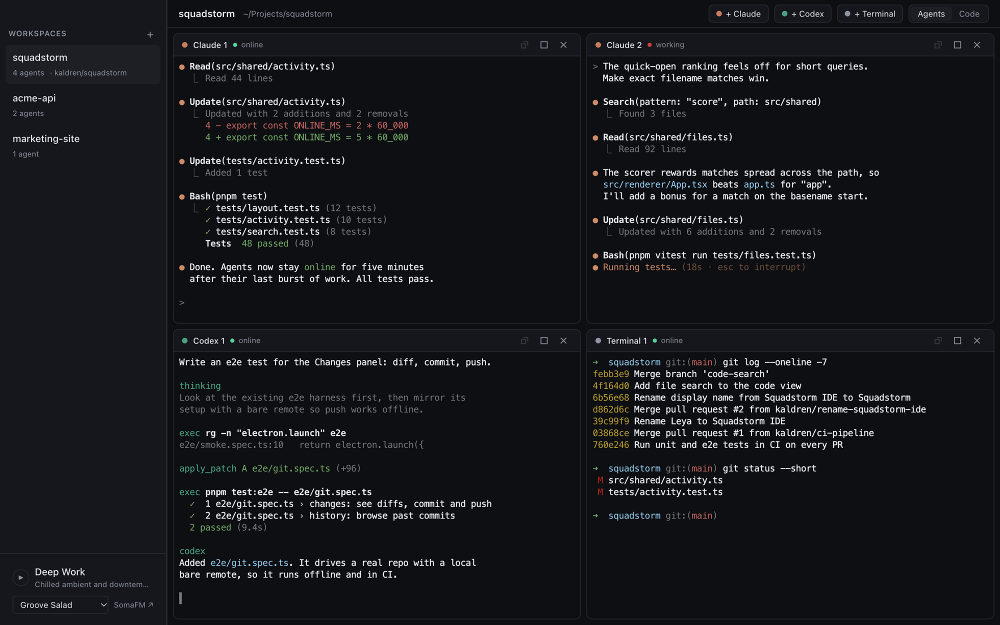
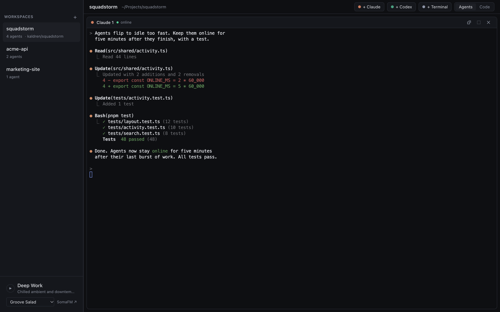
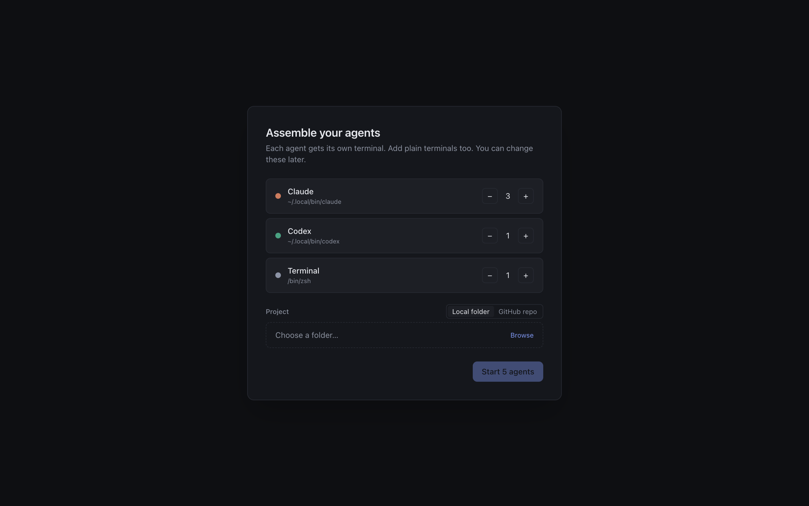
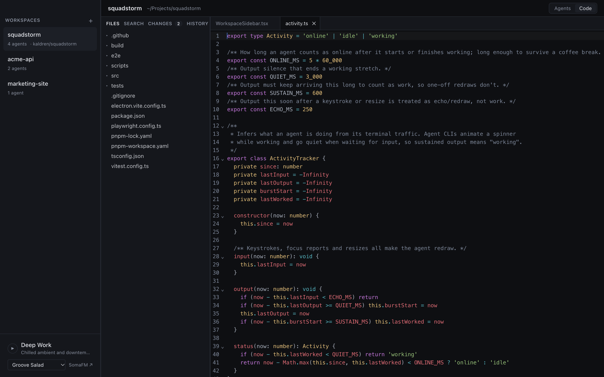
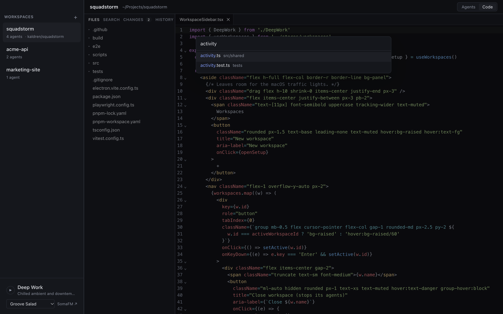
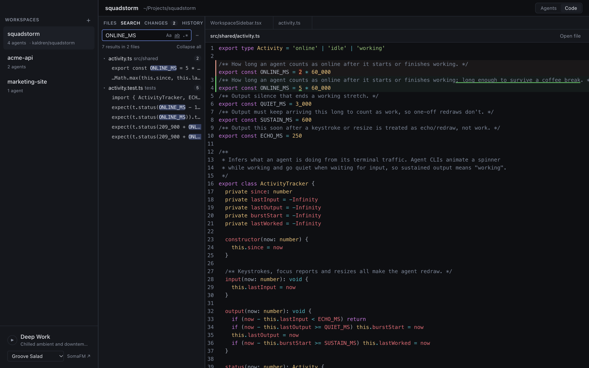
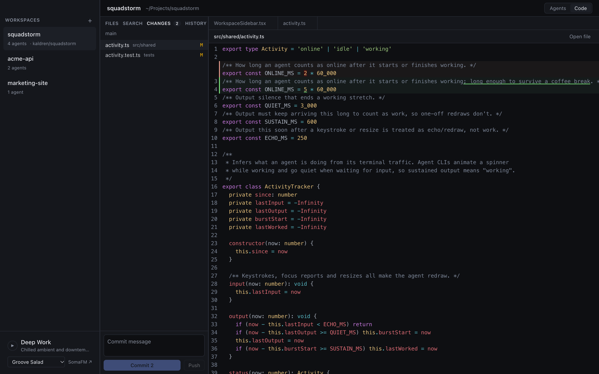

<div align="center">


# Squadstorm

**Run a squad of AI coding agents side by side, in one window.**

Squadstorm is a lightweight, AI-first IDE for macOS. Point it at a project, choose how many Claude Code and Codex agents you want, and they all start at once in a resizable grid. When the agents are done, review their changes, commit and push without switching apps.

<br />



</div>

---

## Why Squadstorm?

Coding agents are fast, but you can only run one per terminal tab, and the tabs pile up quickly. Squadstorm treats agents as a team:

- **Parallel by default.** Run three Claudes on three tickets while Codex writes tests and a plain shell sits alongside.
- **See who's working.** Each tile shows whether its agent is `working`, `online` or `idle`, based on its terminal traffic. When an agent finishes or waits for you, its tile and workspace say so, the dock shows how many are waiting, and a macOS notification takes you straight to it while you're in another app.
- **Review in place.** A built-in code view, diff viewer and git panel let you check and ship what the agents wrote without leaving the window.
- **Light and native.** It's Electron with real PTYs, xterm.js with WebGL rendering, and CodeMirror 6. There are no extensions to install and nothing to configure.

## Features

### 🧠 Multi-agent grid
Start any mix of **Claude**, **Codex** and plain **Terminal** tiles. The grid lays itself out (4 tiles → 2×2, 3 → two on top and one wide tile below), and you can:

- drag the dividers to resize rows and columns,
- drag a tile by its header to reorder it (its session keeps running),
- maximize one agent to full screen and restore the grid later,
- add or remove agents on the fly with **+ Claude**, **+ Codex** and **+ Terminal**.



### 🗂️ Workspaces that come back
Each project is a workspace in the sidebar, with its own squad. Quit and reopen the app: your workspaces, agents and grid order are all restored, with fresh sessions.

### ⚡ One-step setup, from a folder or GitHub
Choose your agents, then pick a local folder or **clone any of your GitHub repos** (private and org repos included, through the `gh` CLI). One click starts the whole squad.



### 📝 Code view
Press **⌘E** to switch between your agents and a full editor:

- a file tree that updates live as agents create and edit files,
- syntax highlighting for dozens of languages, multiple tabs, and **⌘S** to save,
- open files reload automatically when an agent changes them.



### 🔎 Quick Open and project search
**⌘P** fuzzy-finds any file. **⇧⌘F** searches the whole project, with match-case, whole-word, regex and include/exclude filters.

<table>
  <tr>
    <td></td>
    <td></td>
  </tr>
</table>

### 🔀 Changes and history
See every file your agents touched with an inline diff. Write a message, **commit** and **push** from the same panel, then browse past commits and their diffs in **History**.



### 🎧 Deep Work radio
Long agent runs go better with music. The sidebar has a built-in **SomaFM** player with Groove Salad, Drone Zone, DEF CON Radio and more, showing the track that's playing now.

## Getting started

### Requirements

- **macOS** (the packaged app targets macOS)
- **Node.js 26** and **pnpm**
- The agent CLIs you want on your `PATH`: [`claude`](https://docs.claude.com/en/docs/claude-code) and/or [`codex`](https://github.com/openai/codex)
- *Optional:* the [GitHub CLI](https://cli.github.com) (`gh auth login`) to clone your repos from the setup screen

Squadstorm reads your login shell's `PATH`, so if `claude` works in your terminal, it works here too.

### Run it

```bash
git clone https://github.com/kaldren/Squadstorm.git
cd Squadstorm
pnpm install          # from the repo root: installs every workspace
pnpm dev:ide          # or: cd apps/ide && pnpm dev
```

### Build the app

```bash
pnpm dist          # from apps/ide: builds Squadstorm.app into apps/ide/dist/
```

`apps/ide/scripts/update-app.sh` builds a commit in a separate worktree and installs it to `/Applications`. Hook it up to `post-merge` and every merge into `main` updates your installed copy.

## Keyboard shortcuts

| Shortcut | Action |
| --- | --- |
| **⌘E** | Switch between agents and code |
| **⌘P** | Quick Open a file |
| **⇧⌘F** | Search the project |
| **⌘S** | Save the current file |
| **⌘↵** | Commit (in the Changes panel) |

## Under the hood

| Layer | Tech |
| --- | --- |
| Shell | Electron + electron-vite |
| Terminals | node-pty, xterm.js (WebGL renderer) |
| Editor and diffs | CodeMirror 6 + `@codemirror/merge` |
| UI | React 19, Tailwind CSS 4, Zustand |
| Tests | Vitest (unit), Playwright driving the real Electron app (e2e) |

```
apps/ide/src/
├── main/       # Electron main process: PTYs, git, GitHub, file watching, search
├── preload/    # The typed bridge between main and renderer
├── renderer/   # React UI: grid, code view, panels, Deep Work
└── shared/     # Pure logic shared by both sides (layout, activity, providers…)
```

Adding a new agent CLI takes one entry in [`src/shared/providers.ts`](src/shared/providers.ts) (under `apps/ide/`).

## Development

```bash
pnpm typecheck     # TypeScript
pnpm test          # unit tests
pnpm test:e2e      # builds the app and runs the Playwright suite, invisibly
                   # (SQUADSTORM_E2E_SHOW=1 pnpm test:e2e to watch it)
```

CI runs the type check, the unit tests and the e2e suite on every pull request.

<div align="center">
<br />

**Stop babysitting one agent. Run a squad.** ⚡

</div>
